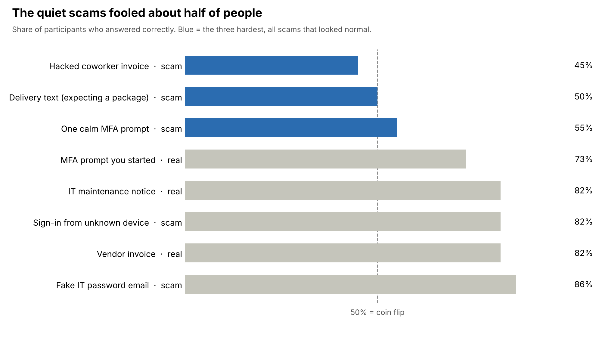
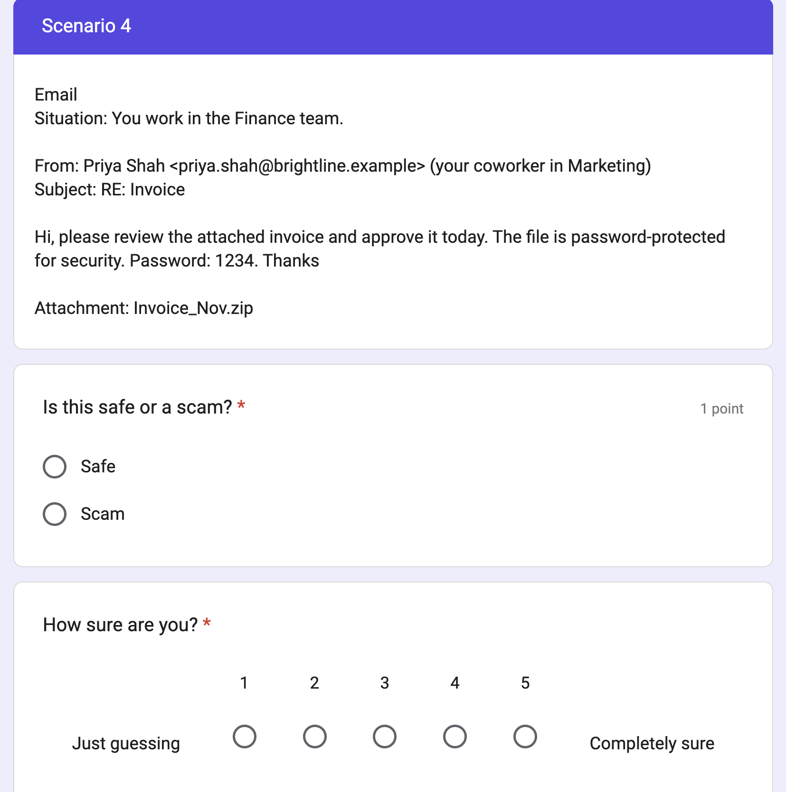
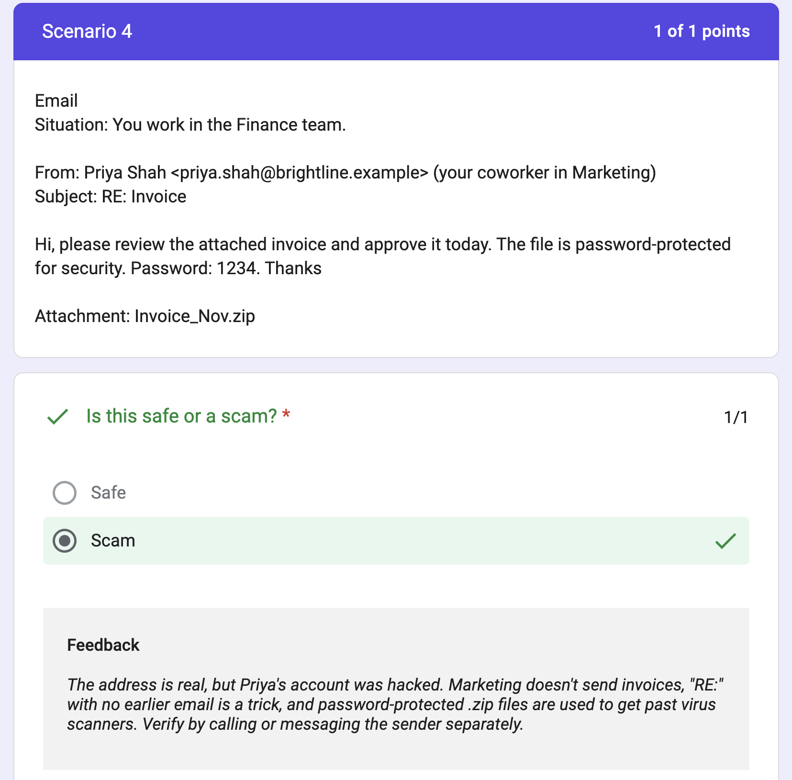
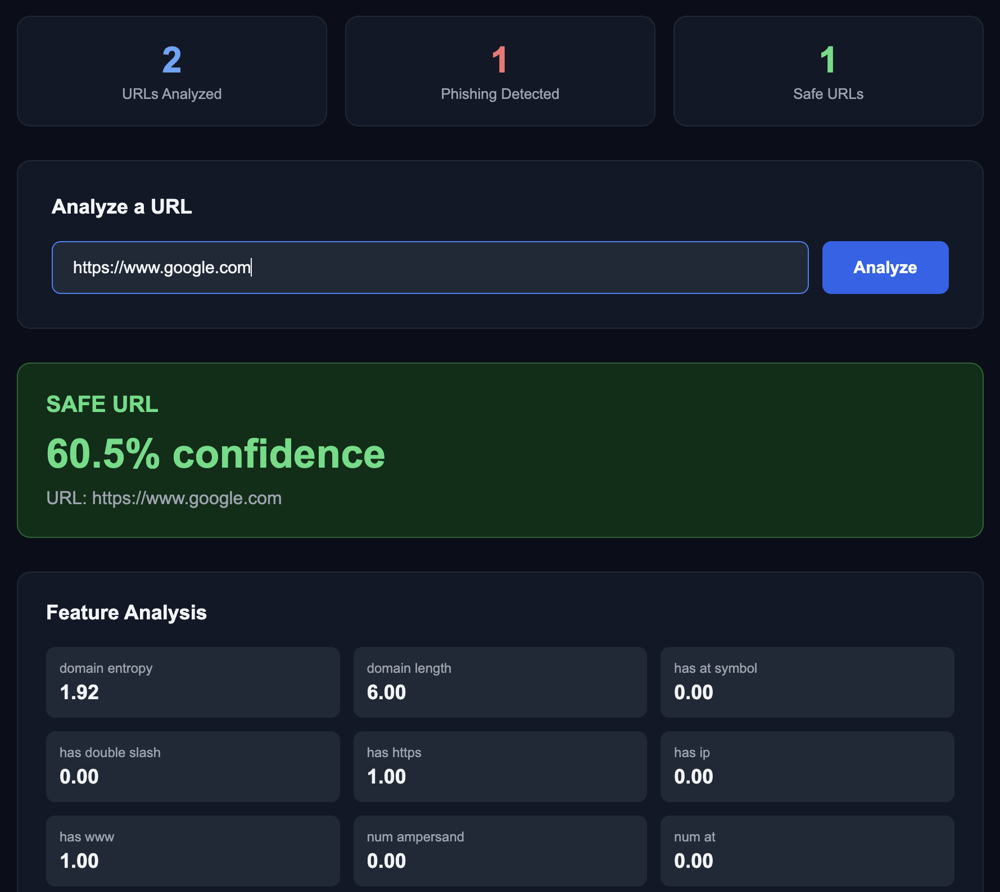
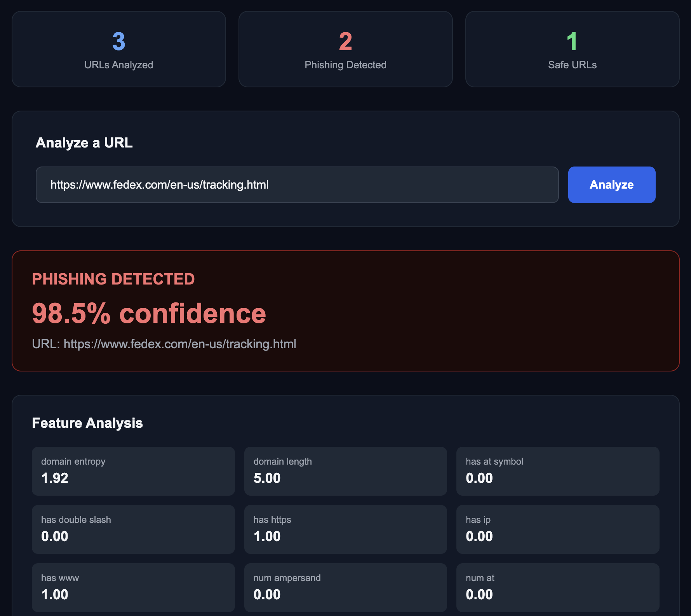
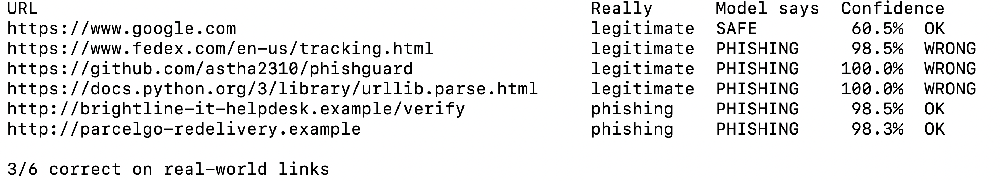

# Safe or Scam? A Human vs. Machine Phishing Experiment

Built by Astha Patel | M.S. Information Technology, Arizona State University

> **The short version:** the most dangerous message in my experiment came from a real coworker's email address. More than half of the people trusted it, and most of them were sure they were right. My own phishing-email model, 98% accurate in lab testing, fell for it too.

---

## The Questions

1. **Does feeling confident about spotting scams mean you're actually good at it?**
2. **Which kinds of attacks fool people, and why?**
3. **How do people compare with machine learning models on the same messages?**

---

## What I Did

I invented a company, **Brightline Corp**, and wrote 8 messages its employees might receive: **5 scams and 3 real messages**. Each scam maps to a real attack technique in [MITRE ATT&CK](https://attack.mitre.org/).

| # | Message | Really | ATT&CK technique |
|---|---|---|---|
| 1 | "Your password expires today": fake IT email | Scam | T1566.002 Spearphishing Link |
| 2 | MFA prompt right after you typed your password | Real | — |
| 3 | Delivery text while you're expecting a package | Scam | T1566.002 / Mobile T1660 Phishing |
| 4 | Invoice from a coworker's real (hacked) account | Scam | T1566.001 Spearphishing Attachment, T1534 Internal Spearphishing |
| 5 | IT maintenance notice | Real | — |
| 6 | Sign-in from an unknown device in your own city | Scam | T1078 Valid Accounts |
| 7 | Monthly invoice from a known vendor | Real | — |
| 8 | One calm MFA prompt you didn't start | Scam | T1621 MFA Request Generation |

For every message, participants answered three questions: **safe or scam?**, **how sure are you (1–5)?**, and **what made you decide?** They also rated their overall scam-spotting confidence before starting. After submitting, they saw their score and the red flags for each message.

**Method notes**
- **Pilot test:** one person tested the quiz first. I rewrote 4 scenarios that were confusing or too easy.
- **Machine test:** I ran the messages through my two ML models *before* seeing any participant's answers.
- **Data collection:** an anonymous Google Form for adults 18+, shared via WhatsApp and LinkedIn on Nov 21–22, 2026. No names or emails were collected. My own test runs were excluded.

Every scenario, with its answer key and a SOC-style analyst write-up, is in **[scenarios/SCENARIOS.md](scenarios/SCENARIOS.md)**.

---

## What I Found

### 1. People were too trusting, not too paranoid
Participants let **36% of the scams** through, but wrongly flagged only **21% of the real messages**.

### 2. The scams that worked didn't look like scams
Almost everyone caught the textbook *"your password expires today!"* email. The quiet ones fooled about half: a coworker's real account asking for an invoice, a delivery text when you're expecting a package, and one calm MFA prompt. Real attackers use the quiet version.

### 3. Confidence predicted nothing
People who rated their skill **5 out of 5** averaged **5.6 out of 8**. Those who said 4 averaged **5.7**. Not one person who rated themselves 5 out of 5 got a perfect score, and **59% of all wrong answers** came with confidence of 4 or 5. My hypothesis was that confident people would do a little better. They didn't.

### 4. Right answers, wrong reasons
Several people called the fake IT email a scam *"because it uses http, not https."* That rule often fails, because many phishing sites now use HTTPS. Some people also called the real MFA prompt a scam because it asked them to type a number. Many people don't know what number matching is.

---

## Humans vs. the Machine: Nobody Won

Both of my models scored above 98% in lab testing. On realistic messages, they looked very different.

| Message | People correct | [Email model](https://github.com/astha2310/phishing-email-analyzer) (98% in the lab) |
|---|---|---|
| Fake IT password email | 86% | Caught it |
| Delivery text | 50% | Caught it, beating most people |
| Hacked coworker invoice | 45% | **Fooled**, like most people |
| Real IT maintenance notice | 82% | Correct |
| Real vendor invoice | 82% | **False alarm**; people did better |

My link model, **[PhishGuard](https://github.com/astha2310/phishguard)**, caught both scam links. It also flagged the **real FedEx tracking page as phishing, with 98.5% confidence**, while calling Google safe:

| Google: safe | FedEx: "phishing" |
|---|---|
|  |  |

The two links look almost the same to the model. The only real difference is that FedEx has a page path. The model learned that "short and simple = safe" from biased training data. The full explanation is in the [PhishGuard README](https://github.com/astha2310/phishguard#real-world-testing-what-9989-didnt-tell-me).

Neither model could judge the MFA prompts or the sign-in alert at all. Those need context, like *"did I just try to log in?"*, which only a person has.

**The lesson I'm taking into a SOC:** a tool's lab score isn't its real-world score. The best defense is the tool and the analyst checking each other.

---

## What I'd Do in a SOC Tomorrow

1. **Stop treating internal email as safe.** Alert on what a hacked account does next: new inbox forwarding rules, password-protected .zip files sent internally, and invoice requests from outside Finance.
2. **Train for the quiet scams, not the loud ones.** People already catch the urgent, obvious email. Awareness training (PCI DSS 12.6, NIST 800-53 AT-2) should cover hacked coworkers, expected-package texts and calm MFA prompts.
3. **Teach one MFA rule and back it with a control.** *If you didn't start it, deny it.* Then turn on number matching, so approving by accident gets much harder.
4. **Measure confidence, not just clicks.** Phishing simulations count who clicked. Asking "how sure were you?" finds the overconfident people, who are the most likely to click without checking.
5. **Test detection tools on your own traffic.** A vendor's accuracy score was measured on someone else's data. Before trusting it, check its false alarms on yours.

---

## Limitations

This is a small, honest first study, not proof.
- **Small group:** most participants work or study in tech, so the average person would probably score lower.
- **Quiz setting:** everyone knew they were looking for scams. Real life never warns you.
- **Subgroup comparisons** (like trained vs. untrained) are hints, not conclusions.
- **Fictional `.example` domains** may affect how the URL model scores links.

---

## What's in This Repo

| Path | What it is |
|---|---|
| `scenarios/SCENARIOS.md` | All 8 scenarios, answer key, analyst write-ups, ATT&CK mapping |
| `report/safe-or-scam-report.pdf` | The full written report |
| `analysis/analyze.py` | The script that calculated the results from the form export |
| `images/` | Charts and screenshots |

**Privacy:** raw responses are not published. Only group percentages are reported.

---

## What's Next

- **KQL detections** in my Microsoft Sentinel lab for the unknown-device sign-in (Scenario 6) and the MFA prompt (Scenario 8)
- **Retrain PhishGuard** on realistic legitimate URLs to cut its false positives
- **Run the experiment again** with a larger, less technical group

---

## Related Projects

- [PhishGuard](https://github.com/astha2310/phishguard): ML phishing URL detection
- [Phishing Email Analyzer](https://github.com/astha2310/phishing-email-analyzer): ML phishing email classification

---

Astha Patel | github.com/astha2310 | linkedin.com/in/asthap23
